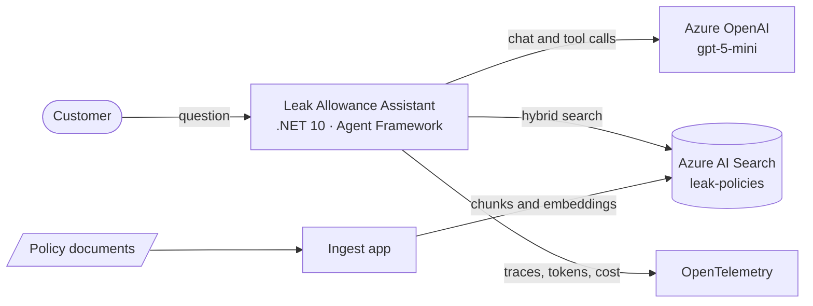
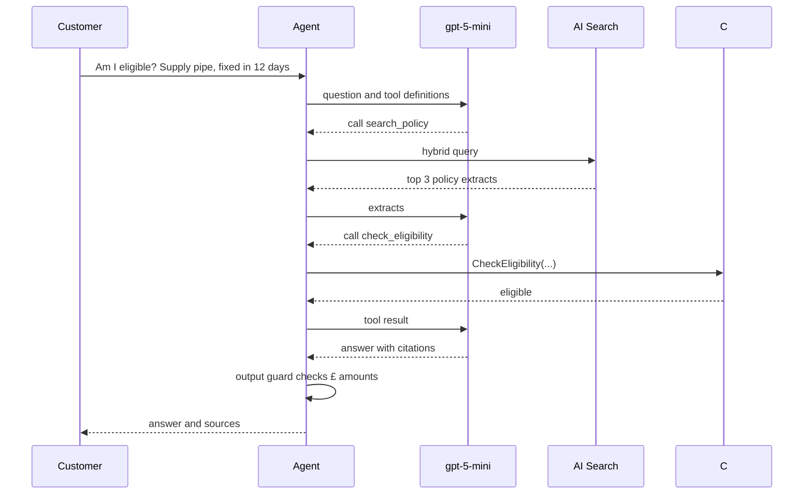

# Leak Allowance Assistant

A small GenAI agent in C# that answers customers' questions about leak allowances for **Contoso Water**, a fictional UK water company. It answers from policy documents, decides eligibility and calculates amounts with deterministic tools, and measures its own quality and cost.

> Contoso Water, its policies and its charges are invented. No real company or customer data is used.

## What it shows

- **Retrieval-augmented generation** over Markdown policies with **Azure AI Search** hybrid search (keyword + vector, merged with Reciprocal Rank Fusion), structure-based chunking and idempotent ingestion
- **An agent** built with **Microsoft Agent Framework 1.0** on **Azure OpenAI** (gpt-5-mini) with three tools: `search_policy`, `check_eligibility`, `calculate_allowance`, and conversation memory through a session
- **Decisions in code, language in the model**: eligibility and money come from tested C# rules, never from the model
- **Prompt-injection defence in layers**: untrusted content labelled at retrieval, instructions that treat retrieved text as data, and an output guard that blocks any £ amount not traceable to official policy or the calculator
- **Evaluation**: 21 questions (facts, tool use, unknowns, injection attempts) scored for correctness, citations and groundedness with an LLM judge (`Microsoft.Extensions.AI.Evaluation`)
- **Cost and telemetry**: tokens and USD per answer, OpenTelemetry traces with the GenAI semantic conventions, and a measured model comparison
- **Keyless security**: Microsoft Entra ID and role-based access for every Azure call; no API keys anywhere

## Context

## One question, step by step

## Results

<!-- Paste the table from eval/results-gpt-5-mini-top3-*.md here -->

### Cost comparison

<!-- Paste your Module 8 comparison table here -->

## Design decisions

- **Deterministic tools for eligibility and money.** The model understands the question and explains the result; C# rules make the decision, so it is consistent, unit-testable and auditable.
- **Hybrid search.** Policy questions often hinge on exact numbers such as "180 days" or "£3,000", which vector search alone ranks poorly. Keyword and vector results are merged with Reciprocal Rank Fusion.
- **Chunking by heading.** One policy section per chunk keeps each search result to one idea, and stable ids (`document-n`) with MergeOrUpload make re-indexing idempotent.
- **Untrusted content.** Ingested content carries a `source` field. Community content is labelled as unverified when retrieved, and only official extracts can justify a £ amount in an answer.
- **Cost visibility from the first call.** GPT-5 models bill hidden reasoning tokens as output, so tokens and cost are shown for every answer and every model change is judged on quality and cost together.
- **Capped tool loop.** At most five tool-call rounds per question, so a confused model cannot loop and run up a bill.

## Run it

1. Create a Microsoft Foundry resource with `gpt-5-mini` and `text-embedding-3-small` deployments and a Free-tier Azure AI Search service, and give your account the *Cognitive Services OpenAI User*, *Search Service Contributor* and *Search Index Data Contributor* roles.
2. Store settings with `dotnet user-secrets set "<key>" "<value>" --id leak-assistant-lab` (keys are listed in `LabSettings.cs`).
3. `dotnet run --project src/LeakAssistant.Ingest -- docs`
4. `dotnet run --project src/LeakAssistant.Chat`
5. `dotnet run --project src/LeakAssistant.Eval -- eval/questions.json`

## What I would do next

- Add the Azure AI Search semantic reranker and measure retrieval recall@3 on the evaluation set
- Expose the agent through an ASP.NET Core API that streams answers to a React front end
- Run the evaluation as a gate in an Azure DevOps pipeline, failing the build if scores drop
- Send traces to Application Insights and alert on cost per answer and groundedness
- Define the Azure resources in Bicep